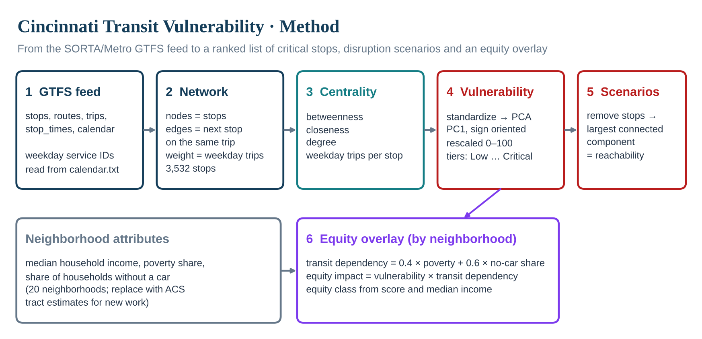

# 🚌 Cincinnati Transit Vulnerability

> **Identifying critical failure points in the Cincinnati Metro (SORTA) bus network with graph theory and GTFS data.**

[](https://omid-mansourihanis.github.io/cincinnati-transit-vulnerability/)
[](https://www.python.org/)
[](https://www.go-metro.com/about/developer-data/)
[](https://doi.org/10.17632/knxmkcsg9m)
[](LICENSE)

**Live map:** <https://omid-mansourihanis.github.io/cincinnati-transit-vulnerability/>

---

## 🎯 Question

*If a bus stop or transit center goes offline because of an accident, a flood or an infrastructure failure, how much of the network loses connectivity, and who depends on it most?*



A two-page summary of the results is in [`docs/executive_summary.pdf`](docs/executive_summary.pdf).

---

## 🔑 Results (weekday network, 3,532 stops)

- **Criticality is concentrated downtown.** 17 stops score 50 or higher, and 10 of them are downtown.
- **The network survives losing its hub.** Closing all six Government Square bays cuts off only 6 stops (99.83% reachability), because each bay is a separate stop and the rest of the network stays connected.
- **Flooding is the most disruptive scenario.** Removing the 235 stops in the riverfront FEMA Zone AE leaves 93.18% of stops reachable and cuts off 241.
- **355 stops (10%) carry high or critical equity risk**, led by Over-the-Rhine, Walnut Hills, West End and Mount Auburn.

### Top critical stops

| Rank | Stop | Neighborhood | Score |
|---|---|---|---|
| 1 | Government Square Area F | Downtown | 100.0 |
| 2 | Government Square Area H | Downtown | 90.2 |
| 3 | 5th St & Sycamore St | Downtown | 87.2 |
| 4 | 5th St & Vine St | Downtown | 79.0 |
| 5 | 7th & Central Ave | Downtown | 76.7 |

### Disruption scenarios

| Scenario | Stops removed | Reachability | Stops cut off |
|---|---|---|---|
| Government Square shutdown | 6 | 99.83% | 6 |
| Ohio River flood (FEMA Zone AE) | 235 | 93.18% | 241 |
| Downtown power outage (0.5 mi of Government Square) | 96 | 97.11% | 102 |
| Top 5 critical stops fail | 5 | 99.86% | 5 |

*Reachability* is the share of stops that remain in the largest connected component after the scenario's stops are removed.

---

## 🗂 Project structure

```
cincinnati-transit-vulnerability/
├── README.md
├── requirements.txt
├── .gitignore
├── LICENSE
├── index.html                          ← interactive web map (GitHub Pages)
├── assets/                             ← web map: css, js, data/stops.json (published results)
├── notebooks/
│   ├── 01_data_ingestion.ipynb         ← download GTFS, quality checks, weekday service IDs
│   ├── 02_network_construction.ipynb   ← NetworkX graph of stops and segments
│   ├── 03_centrality_analysis.ipynb    ← centrality, PCA score, scenarios, Folium map
│   └── 04_equity_analysis.ipynb        ← transit dependency, equity impact, equity class
├── src/
│   ├── gtfs_loader.py                  ← download and parse GTFS
│   ├── network_builder.py              ← build the NetworkX graph
│   ├── centrality.py                   ← centrality metrics and PCA vulnerability score
│   ├── disruption_simulator.py         ← scenario and cascade engine
│   ├── equity.py                       ← equity overlay
│   └── viz.py                          ← Folium and Plotly helpers
├── app/
│   └── streamlit_app.py                ← dashboard
├── data/reference/                     ← neighborhood values used by the equity overlay
├── tests/test_pipeline.py
└── docs/
    ├── methodology.png
    └── executive_summary.pdf
```

Raw GTFS data is **not** committed. Notebook 01 downloads it from SORTA's public URL into `data/raw/`; intermediate results go to `data/processed/`. Both folders are ignored by git.

---

## ⚡ Quick start

```bash
git clone https://github.com/Omid-Mansourihanis/Omid-Mansourihanis.github.io
cd Omid-Mansourihanis.github.io/cincinnati-transit-vulnerability
pip install -r requirements.txt

jupyter notebook notebooks/            # run 01 → 04 in order
streamlit run app/streamlit_app.py     # dashboard; uses the published results until you run the notebooks
python -m pytest tests                 # pipeline and equity tests
```

To view the web map locally, serve this folder (`python -m http.server`) and open <http://localhost:8000>.

---

## 📊 Method

Adapted from the framework in *"From Response to Prevention: A Multi-City ML Framework for Transportation Network Vulnerability Prediction."*

1. **Network.** Stops are nodes; a directed edge joins two consecutive stops on a trip and is weighted by the number of weekday trips on that segment. Weekday service IDs are read from `calendar.txt` (services running Monday to Friday) instead of being hard-coded.
2. **Centrality.** Betweenness, closeness and degree centrality on the undirected graph, plus weekday trips per stop as a demand proxy.
3. **Vulnerability score.** The four metrics are standardized and the first principal component is rescaled to 0–100. A principal component's sign is arbitrary, so it is oriented to give the most central stops the highest scores.
4. **Scenarios.** The stops in each scenario are removed and the largest connected component is measured again.
5. **Equity overlay.** Each stop takes the values of its neighborhood. Transit dependency = 0.4 × poverty share + 0.6 × share of households without a car; equity impact = score × transit dependency; the equity class combines the score with neighborhood median income (`src/equity.py`). These rules reproduce the published values for 3,530 of 3,532 stops, and `tests/test_pipeline.py` checks this.

### Limitations

- Disruption is measured as lost **connectivity**, not as added travel time, crowding or missed trips, so the scores identify structural chokepoints rather than predict ridership impacts.
- The equity overlay uses one value per neighborhood for 20 neighborhoods. These are coarse; tract or block-group ACS estimates joined by location would sharpen the equity results.
- The flood scenario needs the FEMA Zone AE polygon, which is not bundled here. The 0.5-mile power-outage buffer in notebook 03 selects 89 stops from the published stop list, against 96 in the published scenario, so the original centre or distance method differed slightly.

---

## 📬 Data and credit

- Transit data: [SORTA/Metro developer data](https://www.go-metro.com/about/developer-data/) (GTFS).
- Published results: Mansourihanis, O. (2026). *Cincinnati Metro Transit Network Vulnerability Analysis.* Mendeley Data. <https://doi.org/10.17632/knxmkcsg9m>
- Web basemap: © OpenStreetMap contributors, via OpenFreeMap.

Author: [Omid Mansourihanis](https://omid-mansourihanis.github.io/)
